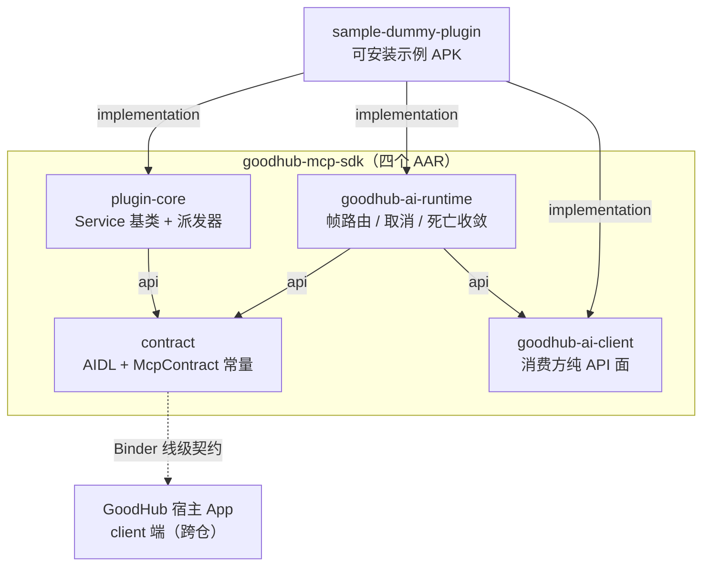

# 架构总览：五模块拓扑与职责边界

## 模块拓扑

`contract` 是 AIDL 接口的唯一物理副本，`IMcpChannel` / `IMcpCallback` 与 `McpContract` 常量由宿主与插件侧共用同一份坐标，杜绝跨仓手抄副本漂移。

## 分层依赖

| 模块 | 产物 | 出向编译依赖 |
|---|---|---|
| `:contract` | `goodhub-mcp-contract.aar` | 无模块内依赖（仅 JVM 单测 junit） |
| `:plugin-core` | `goodhub-mcp-plugin-core.aar` | `api(:contract)`；零第三方运行时依赖 |
| `:goodhub-ai-client` | `goodhub-ai-client.aar` | 仅 `kotlinx-coroutines-core`；零模块内依赖 |
| `:goodhub-ai-runtime` | `goodhub-ai-runtime.aar` | `api(:contract)` + `api(:goodhub-ai-client)` + coroutines |
| `:sample-dummy-plugin` | `sample-dummy-plugin-*.apk` | `implementation` 上述三个工件 |

编译依赖方向为 `runtime → client`；业务层只面向 `GoodHubAi` 门面，运行时实现由 runtime 工件的 library Manifest 声明的 `AiTransportService` 承载，业务层零 Manifest、零 IPC 感知。`:plugin-core` 用 `api` 而非 `implementation` 暴露 `:contract`，因为第三方插件 App 编译期需同时可见契约类。

## 职责边界

**SDK 做（server 端）**：实现 `IMcpChannel.Stub`；反射生成 `tools/list` Schema 与路由 `tools/call`；异常隔离转 `-32603`；异步长任务与进度推送；反向请求发起；AI 消费侧的请求帧构造、多帧关联、phase 翻译与取消收口。

**SDK 不做（归宿主 client 端）**：`bindService` / `ServiceConnection` / `DeathRecipient` 连接状态机；挂起请求队列与超时预算；命名主权仲裁；同签名判定与信任卡白名单；配额与内容围栏；大报文解包侧。SDK 只上报 `serverId`。

`mcpConsumable` 与工具 `visibility` 是给宿主的声明，不是 SDK 的访问控制：不改变 `tools/list` 条目数，也不拦截 `tools/call`。

## 版本事实源

`VERSION` 文件是仓级版本唯一出处，`build.gradle.kts` 由此派生 `project.version`，`BuildConfig.SDK_VERSION` 与四个 Maven 坐标同源。CI 在 tag 发布前校验 tag 与 `VERSION` 一致。
