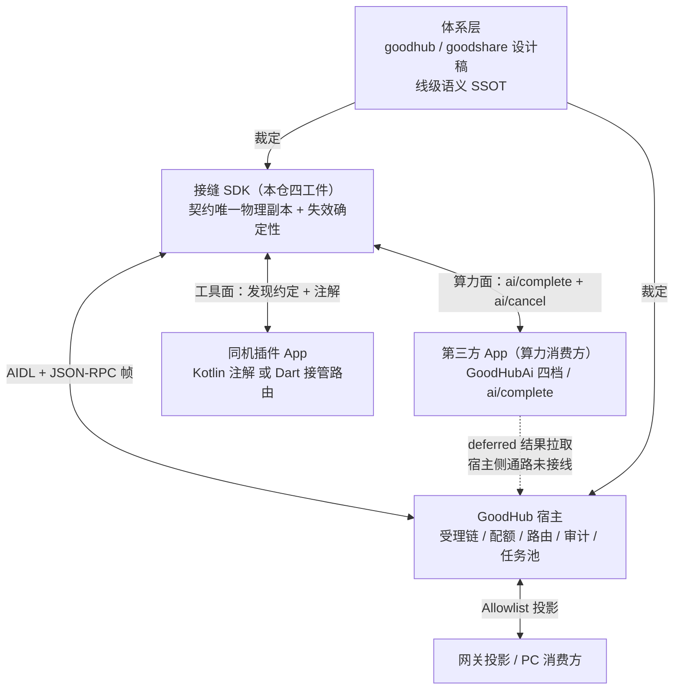

# 接缝 SDK 定位与能力评估

> 代号说明：`A`~`E` 为短板分类锚点，仅用于本文交叉引用；`P0`~`P3` 为处置优先级（P0 最高）。「SDK」指本仓四个 AAR 工件，「宿主」指 GoodHub App（跨仓），「体系层」指 goodhub / goodshare 仓内裁定线级语义的设计稿。「工具面」指宿主消费插件能力的价值流，「算力面」指第三方 App 消费宿主 Agent 模型推理能力的价值流。

## 定位：体系内接缝执行件

本仓不是通用 SDK，也不面向任意宿主、任意平台或任意第三方生态。它是 GoodHub 体系内连接「宿主 ↔ 同机插件」这一条具体接缝的**协议执行件**：体系层裁定线级语义，本仓把它固化为唯一物理副本，并让接缝断开时确定性地失败。

同一条 AIDL 接缝上并存**两条方向相反的价值流**，二者都是主交付路径：工具面由宿主消费插件能力（`tools/call`），算力面由第三方 App 消费宿主 Agent 的模型推理能力（`ai/complete` 经 `IMcpCallback.onEvent` 推带 id 的反向请求帧、`answerReverse` 回程）。传输层宿主仍是 `bindService` 的 client（bind 消费方的传输服务），语义层消费方才是请求方；角色并未反转，宿主始终握有受理链、配额、路由与审计主权。算力面自 0.4.0 起已独立立法：`ai/complete` / `ai/cancel` 两个原语、`:goodhub-ai-client` + `:goodhub-ai-runtime` 双件、对外接入手册与网关投影。同一个 App 可以同时是工具面插件与算力面消费方。

由此，**开放扩展点、可替换传输、多宿主兼容、跨平台后端都不属于本仓的评价指标**。协议变更必须改核心分派表并发版，这个「封闭」是防漂移闸门，不是缺陷。两条流共用下列六维评价标准；算力面因宿主主权更重，「不越权」与「失效确定」的权重更高。

## 评价维度与现状

接缝执行件的质量用六把尺子量，不用通用 SDK 的扩展性尺子。

| 维度 | 含义 | 现状 | 判断 |
|---|---|---|---|
| 契约保真 | 下发线级形状与体系裁定逐字段一致 | 常量冻结自检齐备；报文形状主要靠文档表格与人工核对 | 中上 |
| 漂移阻断 | 阻止多个消费方各自演化出协议方言 | AIDL 单物理副本、method 与十二码常量单源、源级破层断言 | 好 |
| 失效确定 | 断连 / 不识别 / 宿主死亡时结构化暴露，不静默 | `-32601` 回落、`HOST_OFFLINE` 收口、终帧投递回报、错误帧回显 id | 好 |
| 升级单向 | 纯增量，旧宿主与新 SDK、旧插件与新宿主均不炸 | `contract_version = v1` 支撑六个版本且 AIDL 零改动；`allow_deferred` 缺省 false、`hasPrompts=false` 自动降级 | 很好 |
| 接入摩擦 | 体系内新成员接入成本 | 注解声明、零手写 AIDL、Dart 侧可整体接管路由 | 好 |
| 不越权 | 不触碰宿主侧决策 | 命名仲裁、安全闸门、聚合决策、大报文解包侧均明确划归宿主 | 很好 |

## 不算短板的缺位

以下能力不在本仓，属体系分工，缺位不构成评估扣分项：`bindService` / `DeathRecipient` / 连接状态机、命名主权仲裁、同签名安全闸门与信任白名单、重试与退避决策（`retryAfterMs` 仅提示）、宿主任务池与执行计费、iOS 传输后端、Manifest 静态语义规范落地。

流式吐字同样不在本仓 v1 的评价范围：`AI_PROGRESS_META_DELTA` 是 v2 预留位，v1 明令禁发射文本（端侧分帧存在 UTF-8 半字符外溢风险），`complete` 为整段返回语义。现有 progress 帧是四值阶段跃迁通知，低频且不含文本增量。

## 能力短板

### A 算力主交付阻断

算力外借与工具面并列为主交付，本项因此不是「旁路未闭合」，而是**主交付链阻断**。

长耗时推理的结果交割依赖 deferred 联合态。该契约本身已完整立法：`task_id`、`expiry_ms`、`pendingDelivery` 态、按内核 UID 寻址、24 小时作废，且「Pull 即交付、严禁依赖 Push」的纪律已经确立（Android cgroup freezer 会吞发往冻结进程的 oneway，且发送方只见成功）；插件侧 `OnDeviceOutcome.parse` 与 `onDeviceTaskStatus` 也已实现。缺的是 `host/onDeviceTaskStatus` 的宿主侧 Binder 反向通路接线。移动端端侧推理动辄数秒至数十秒，这条通路不通意味着结果没有可靠交割路径，属高频必然而非边缘 Case。

算力入口是 `ai/complete`（`McpContract.METHOD_AI_COMPLETE`）。`sampling/createMessage` 已被体系层收敛为其适配壳（封死双推理路由），本仓内只作为反向请求闭环的演示靶子存在，宿主 `onServerRequest` 未接线不影响第三方经 `GoodHubAi` 四档借用算力。`ai/complete` 收编要求宿主不低于收编版构建、旧宿主回 `-32601`，而 SDK 只有 capabilities 布尔降级，没有宿主能力或版本的探测面，调用方无法预判「这次调用会不会被拒」。

**同一原语在 SDK 内部的两条消费路径并不等价**，这是本项更深的闭合点：

| 能力 | `GoodHubAi` 四档 | `McpToolContext.onDeviceComplete` |
|---|---|---|
| 帧发射 / 在途表 | `AiRuntimeCore` + 请求 id 关联 | `reverseRequest` + `CompletableFuture` |
| 取消 | `ai/cancel` + 协程取消自动映射 | 无 |
| 超时 | `completeSync` 10 秒熔断；流档与挂起档无整体超时 | 无 |
| 联合态解析 | 无，`content.text` 直接当产出文本 | `OnDeviceOutcome.parse` |
| 结果拉取 | 无 | `onDeviceTaskStatus` |
| 失败语义 | 十二码 `AiFailure` | 裸异常 |

`AiRequest` 只有 `instruction` / `input` / `config`，没有 `allowDeferred` 与 `expiryMs`；client 与 runtime 全目录不出现 `allow_deferred` / `execution_mode` / `task_id`。即 deferred 只对插件侧路径可用，消费方四档既发不出该参数，也解析不了联合态回执。算力的长任务交付因此被局限在一条并非主入口的路径上。

### B 协议声明与实现不一致

`IMcpChannel.aidl` 注释把 `resources/*` 列为可承载 method，实际分派表只有 `initialize`、`tools/list`、`tools/call`、`prompts/list`、`prompts/get`。同样缺失的还有 `notifications/initialized`、`ping`、`nextCursor` 分页与 `listChanged` 订阅；`initialize` 既不读取请求的 `clientInfo` / `capabilities`，也不返回 `instructions`。

JSON-RPC 层另有保真缺口：不支持 batch；无 `id` 的通知会被当作请求回一个 `id=null` 的响应，这违反 JSON-RPC 2.0「Notification 不得收到任何响应（含 error）」的铁律，严格客户端会把多余帧当作协议违约并打乱反序列化管线；错误码表只定义 `-32601` / `-32602` / `-32603` 三码，而 AI 消费端解析失败时直接使用字面量 `-32600`。

对外接入手册把「后台分析形态（deferred 联合态）」写成经 `completeSync` / `complete` 请求体可发的通用能力，而 `AiRequest` 没有对应字段、`AiRuntimeCore` 也不解析联合态回执。这是落在算力主交付上的又一处声明与实现对不齐。

这里的问题不是「功能少」——体系裁定只做这个子集完全成立——而是执行件与自身契约声明对不上。处置方向是把 AIDL 注释、对外能力表与接入手册收敛到实际子集，而不是补实现。

### C 失效确定性未守全

算力是高消耗资源（端侧电量与发热、云端 Token），下表各项在算力面下放大效应显著。

| 缺口 | 影响 |
|---|---|
| 反向请求的 `CompletableFuture` 无超时 | 宿主静默不答时 `pendingReverse` 在途表常驻；`onDeviceComplete` 与 `onDeviceTaskStatus` 均压在此路，且这条路径没有取消传播 |
| 异步档无整体超时 | 仅 `completeSync` 有 10 秒熔断；`completeStream` 与挂起档只靠调用方协程取消 |
| 无配额与背压 | 异步工具用无界 `newCachedThreadPool`；在途表无上限，宿主侧单任务 NPU 排队时 SDK 侧仍可无限堆积请求 |
| 无重放与幂等 | 宿主重 bind 后在途全量收敛为失败，业务层自行重发，请求 id 无跨连接语义 |
| `@McpTool.timeoutMs` 仅元数据 | 超 5 秒全靠开发者自觉标 `async`；同步派发缺少装配期约束 |
| 工具侧零装配期校验 | `@McpPrompt` 有急扫描 fail-fast，`@McpTool` 却没有：未知参数类型静默 `toString()`、`jsonType` 兜底为 string、`async` 工具缺 `McpToolContext` 也不报错、复杂类型无法表达 |
| 形参名回退无兜底 | 未启用 `-java-parameters` 时 Kotlin 不生成 `MethodParameters` 属性，`@Param` 缺省即回退 `arg0` / `p0`；AAR 侧 `-keepattributes MethodParameters` 只能保留已有属性、无法生成，SDK 也未在装配期探测退化名并 Fail-Fast |

**超时与取消不能互相替代**。给 `CompletableFuture` 挂 `orTimeout` 只让 future 以 `TimeoutException` 异常完成，解决的是调用方不悬挂；它不会发射 `ai/cancel`、不会中断宿主推理，也不会清理 `pendingReverse` 在途表（该表目前仅在 `answerReverse` 回程与帧发射失败两处移除条目）。直接挂超时的结果是留下常驻条目与后台空转的算力，看似修复，实则把「悬挂」换成「泄漏 + 算力浪费」。正确形态是集中式超时调度，超时时同时完成三件事：移除在途条目、异常完成 future、以原请求 id 作 `cancel_id` 发射既有 `ai/cancel`。`orTimeout` / `completeOnTimeout` 在 API 34 与 35 均可用，`minSdk = 34` 下没有平台障碍，障碍在语义而非 API。

### D 接入侧隐性假设与传输边界

静态探测的正确形态是查宿主包本身：以宿主包启动 Activity 为目标（与授权引导件 `AiFailure.createResolutionIntent` 同源），并随 library Manifest 以 `<queries><package>` 声明宿主包，交给 Manifest Merger 合并进最终 App，业务层零感知。

以 `MCP_SERVER` 发现 Action 查宿主包的 service 是错的：该 Action 由插件侧声明，宿主包按设计不声明任何 service。真机 APK 解析（宿主 Manifest 零 service、零 `MCP_SERVER`）与 `cmd package query-services`（命中的 service 全部来自插件 App）双向印证，因此 `queryIntentServices` 恒返回空，其结果不能作为宿主存在性判据。包可见性只是第二层过滤——即便补了 `<queries>`，探测目标不改仍然恒隐藏。此项仍需在装有宿主的真机上复验 `isAvailable == true`。

大报文限制须区分两条线：`128KB` 是体系裁定的**业务预算线**，超线由宿主回 `BUDGET_EXCEEDED` 诚实降级，并非 Binder 物理上限；Binder 侧的真实约束是每进程约 `1MB - 8KB` 的事务缓冲区由所有在途事务共享，`call()` 走同步事务，`onEvent` / `answerReverse` 走约半额的 oneway 异步池。并发长事务滞留会放大溢出风险，而 SDK 在两条通道上都没有并发闸门或序列化管控。README 已知缺口表把 128KB 写成「超过会触发 Binder 事务上限」，属表述不准。

冻结的 `PERMISSION_MCP_SERVER` 常量在 SDK 侧零落地：`plugin-core` 的 library Manifest 为空，示例插件与 AI 消费端传输服务均为 `exported=true` 且未声明 `android:permission`。鉴权归宿主是分工，但接入模板没有演示已冻结常量应有的用法。

另有两项对外已明示的未实现能力：`mcp-blob://` 大报文降级与 Flutter 插件桥（只能用 Kotlin 原生 Service 包装或整体接管路由）。

### E 验证能力不足以证明接缝连通

当前 52 个单测全部是 JVM 单测，`GoodHubPluginService` 的 Binder 侧与 `AiTransportService` 本身没有测试；没有线级报文形状金样本，没有新旧帧兼容矩阵，没有 R8 混淆后 `Class.forName` 自注册的验证，也没有 128KB 边界、超时与并发用例。真机 e2e 分布在宿主与插件仓，本仓无法独立证明接缝是通的。

分派层（`ToolDispatcher` / `PromptDispatcher` / `AiRuntimeCore`）全是纯 Kotlin 加 `org.json`，现有 JVM 单测已能直接断言帧字符串，加一组 JSON 快照断言即可覆盖报文保真，无需引入新测试依赖；只有 Service 与 Binder 生命周期层才需要额外测试设施。

`capabilities.prompts` 曾出现双层嵌套而单测只断言键存在，正是缺少形状金样本的直接后果。补强方向是把封闭做得更机械，而不是增加扩展点。

## 处置优先级

| 优先级 | 处置 | 归属 |
|---|---|---|
| P0 | **打通算力主干**：确认宿主 `ai/complete` 受理链与 `host/onDeviceTaskStatus` Binder 反向通路接线；未通之前对外明确标注 deferred 交付处于不可用状态 | 联合（宿主侧接线）/ SDK（标注） |
| P0 | **收敛单原语的两条消费路径**：为算力消费四档补 deferred 参数、联合态解析与结果拉取，或把接入手册的通用承诺收敛到插件侧路径，二者取一由体系裁定 | SDK / 联合 |
| P0 | **入口可见性真机复验**：SDK 侧探测目标与 `<queries>` 声明已落地，待装有宿主的设备确认 `isAvailable == true`；宿主侧组件声明的跨仓只读结论见移交件 | SDK / 联合 |
| P1 | 增加宿主能力或版本门控的线级表达，让「会不会回 `-32601`」可预判；只做只读记录，不做本地遮罩 | 联合（体系裁定） |
| P1 | 补插件侧 `McpToolContext` 反向请求链路的超时与取消传播，复用既有 `ai/cancel`，不新增原语 | SDK |
| P1 | 在 `call()` 与 oneway 事件面两条通道上加并发闸门与在途表配额；异步工具改有界队列，拒绝映射既有 `RESOURCE_BUSY` + `retry_after_ms` | SDK |
| P1 | `@McpTool` 装配期 Fail-Fast（退化形参名、非法签名、同步超时声明未标 `async`）对齐 `@McpPrompt` | SDK |
| P1 | AIDL 注释、对外能力表与接入手册收敛到实际子集；补齐错误码表并让消费端改用常量；Notification 不回响应 | SDK |
| P2 | 报文形状金样本（纯 JVM 快照）、新旧帧兼容矩阵、R8 自注册验证、128KB / 超时 / 并发边界用例 | SDK |
| P2 | 示例与 library Manifest 演示 `android:permission`；校准 README 的 128KB 表述 | SDK |
| P3 | 大报文降级、Flutter 桥、resources 子集（若体系裁定需要）、流式分片与背压（v2 议题，v1 不发射 delta） | 联合 |

## 结论

短板不是「能力做得少」，而是四件事叠加：算力主交付链有一截不在自己手里却没标清、单原语在 SDK 内部的两条消费路径尚未收敛、协议子集与自身声明对不上、失效确定性仍留了几个靠业务层自觉的口子。补强方向是**闭合与机械保真**，不是增加扩展点或抽传输抽象；算力面因宿主主权更重，这条约束比工具面更硬。

相关事实源：[架构总览](overview.md)、[线级契约冻结面](../reference/contract-freeze.md)、[功能落点索引](../project/index.md)、[对外契约正文](../../api.md)、[AI 接入手册](../../AI_ONBOARDING.md)。
